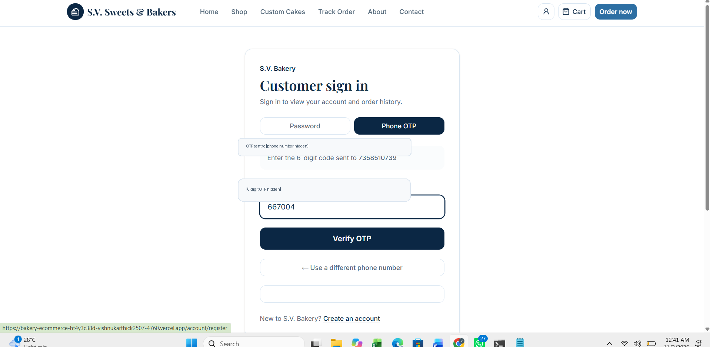
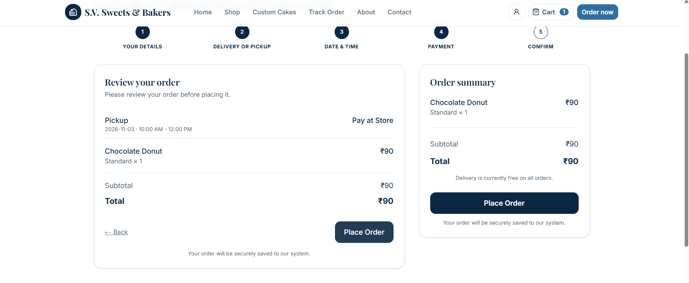
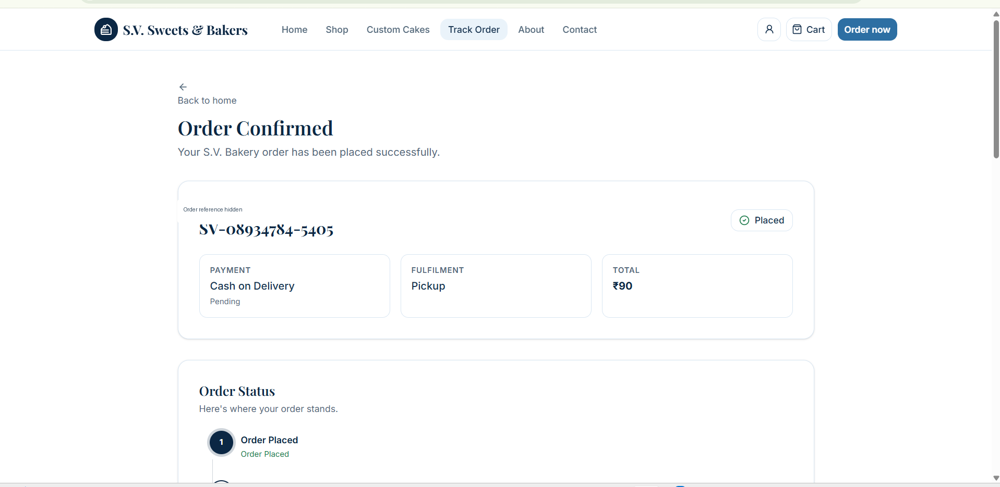
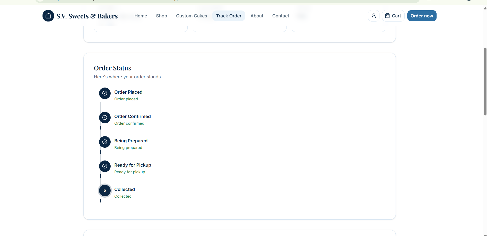
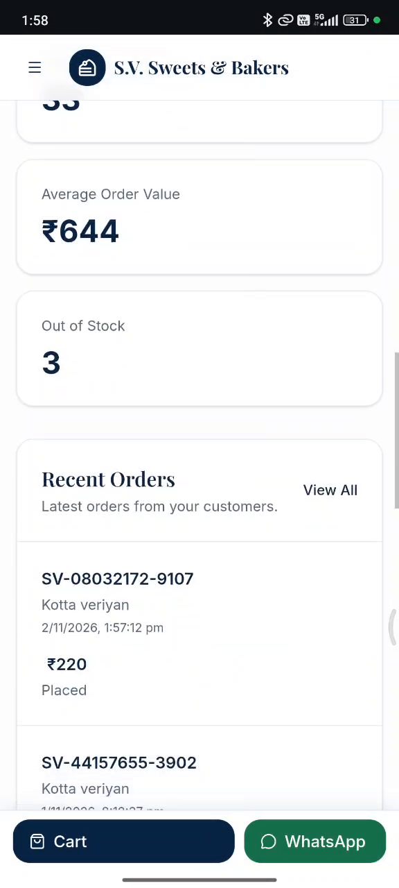
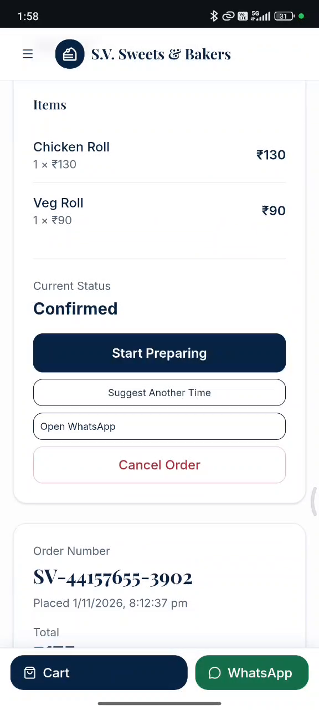
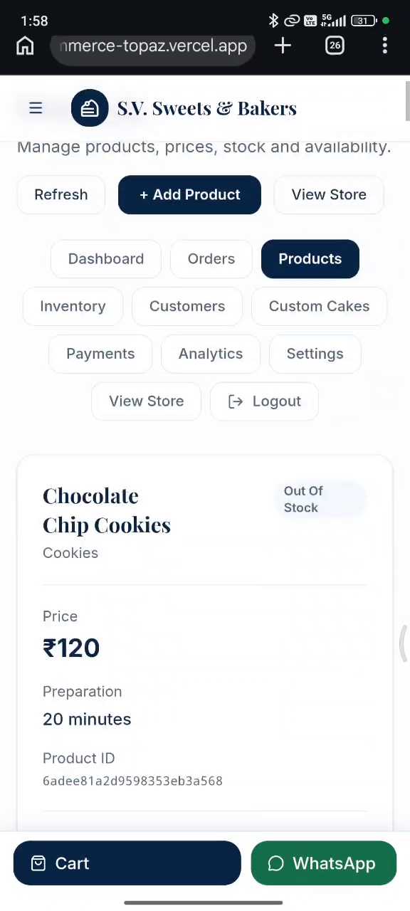
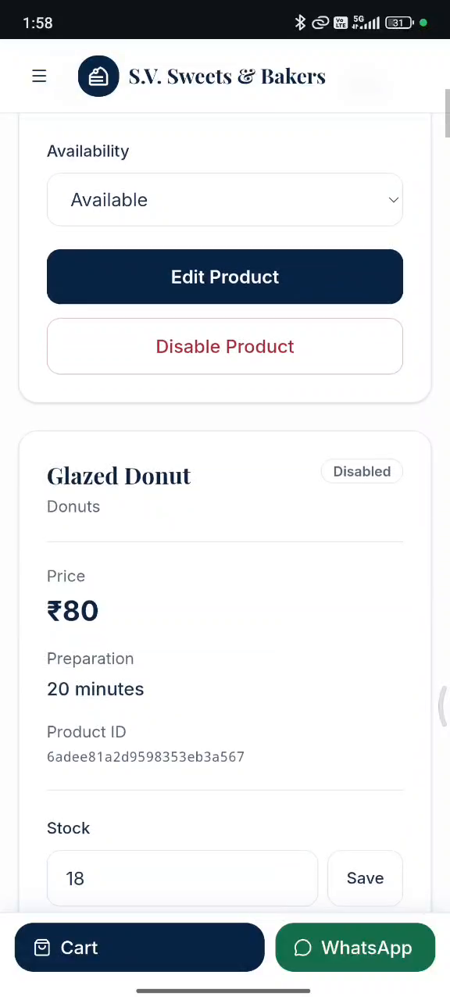
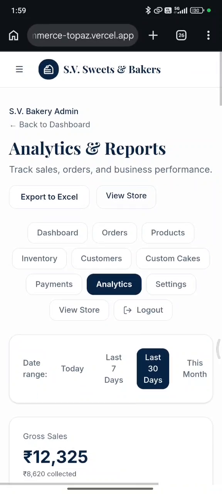

# S.V. Sweets & Bakers

## Full-Stack Bakery E-Commerce Platform

A full-stack bakery e-commerce application with a customer storefront and a dedicated administration dashboard.

## Live Application

\- Customer Website: https://bakery-ecommerce-topaz.vercel.app

\- Backend API: https://bakery-ecommerce-txuz.onrender.com

## Customer Features

\- Phone OTP authentication

\- Browse bakery products and cakes

\- Product details

\- Shopping cart

\- Checkout and delivery information

\- Online payment and Cash on Delivery

\- Order confirmation

\- Order tracking

## Admin Features

\- Secure administrator login

\- Business dashboard

\- Product management

\- Order management

\- Inventory management

\- Customer management

\- Payment management

\- Analytics and reports

\- Custom cake request management

## Technology Stack

| Category | Technologies |

|---|---|

| Frontend | Next.js 16, React 19, TypeScript |

| Styling | Tailwind CSS 4 |

| Backend | Node.js, Express.js 5 |

| Database | MongoDB Atlas |

| Authentication | JWT, HTTP-only cookies, OTP |

| Payments | Razorpay |

| Deployment | Vercel, Render |

| Version Control | Git, GitHub |

## Customer Screenshots

### Phone OTP Sign In

### Checkout

### Order Confirmation

### Order Tracking

## Admin Screenshots

### Admin Dashboard

### Order Management

### Product Management

### Inventory Management

### Analytics and Reports

## Project Objective

To develop an online bakery platform that simplifies customer ordering and helps bakery administrators manage products, orders, inventory and business operations.

## Security

\- Password hashing

\- OTP-based customer verification

\- Secure HTTP-only authentication cookies

\- Environment variables for sensitive configuration

\- Separate customer and administrator access

Never upload environment files, API keys, database credentials or other secrets to GitHub.

## Development

The project uses a separate Next.js frontend and Express.js backend.

Refer to the frontend and backend package.json files for development commands.

\---

Project: S.V. Sweets & Bakers

Repository: https://github.com/vishnukarthick2507/bakery-ecommerce

